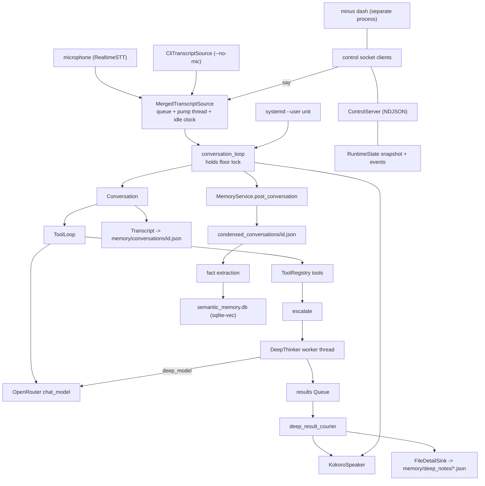

# MINUS — how it works

Read out of the checkout at `2b679c99b98ce966ead75803c22b6f3b8cbb3534` (fork
`StinkyCat0/minusHarness`, byte-identical to `JMANY42/minus`). Line counts and test tallies
were measured on this machine. A claim that names a symbol cites the file defining it.

## 1. What it is

An always-on personal voice assistant. A fast conversational model carries the dialogue and,
for anything needing real reasoning, calls a tool that hands the question to a slower model on
a background thread. Durable facts are extracted from finished conversations into SQLite plus a
vector index and folded into later turns. Speech in through a microphone, out through Kokoro.
A Textual dashboard runs as a *separate* process over a Unix socket, so it can show what a
stopped assistant left on disk and command it while it runs. Deployment is a `systemd --user`
unit around `minus serve` (`src/minus/control/systemd.py`).

`pyproject.toml`: Python `>=3.12`, one console script (`minus = "minus.cli:main"`), six core
dependencies (`httpx`, `openai`, `pydantic`, `pydantic-settings`, `python-dotenv`,
`sqlite-vec`), with torch, PortAudio and Textual behind the `embeddings`, `audio` and
`dashboard` extras. User-facing commands and dashboard keys live in `README.md`.

## 2. Size and shape

| measure | value |
|---|---|
| source | 75 Python files, 13,061 lines under `src/minus` |
| per package | dashboard 3,045/6 · top-level `.py` 2,021/10 · tools 1,955/13 · core 1,239/7 · control 1,157/8 · memory 991/9 · audio 957/6 · services 650/7 · scripts 592/4 · llm 237/3 · system 217/2 |
| tests | 30 files, 9,666 lines, 555 `def test_` functions |
| suite, core-only install | **531 passed, 3 skipped** (modules that `pytest.importorskip` `textual`, `numpy`/`sounddevice`/`kokoro_onnx`) |

`src/minus/cli.py` (argparse, one function per subcommand, heavy imports deferred) →
`src/minus/assembly.py` (**the only module that picks implementations**; the tool, live-config
and control-command tables are all built here) → `src/minus/runtime.py` (behaviour: the
conversation loop, courier, idle rollover, SIGTERM; constructs nothing). Swap points are
`typing.Protocol` in `src/minus/core/protocols.py`: `ChatModel`, `TranscriptSource`,
`SpeechSynthesizer`, `DetailSink`, `FactStore`, `Embedder`. Implementations do not inherit from
them; `tests/fakes.py` holds a plain fake for each.

Fresh-clone trap: `MemoryService.__post_init__` (`src/minus/memory/service.py`) defaults its
store to `paths.semantic_memory_db()`, and `SqliteFactStore.__init__`
(`src/minus/memory/facts/store.py`) opens it without creating the parent directory — so three
tests in `tests/test_memory.py` fail with `unable to open database file` until the gitignored
`memory/` directory exists.

## 3. Topology

## 4. One turn, end to end

1. An utterance reaches `MergedTranscriptSource.__iter__` (`src/minus/core/sources.py`) from the
   pump thread, from `submit()`, or from the CLI source; the consumer polls with a timeout so
   silence is observable and `on_idle` fires between yields.
2. `conversation_loop` (`src/minus/runtime.py`) sets phase `thinking` and takes the **`floor`**
   lock — one `threading.Lock` shared by loop, courier and idle rollover.
3. Inside the lock and *before* generation it captures `speaker.token()`; a token gone stale
   (the user spoke again) drops the reply rather than talking over them.
4. `Conversation.reply` (`src/minus/core/agent.py`) appends a user turn from
   `_build_user_message`: `memory.search_facts(...)` hits that clear the threshold are appended
   under `FACTS_MARKER` (`"RELEVANT FACTS:"`, `src/minus/prompts.py`) as JSON — in the user
   turn, where the model attends to them.
5. `ToolLoop.run` (`src/minus/core/loop.py`) completes, dispatches tool calls, appends results,
   repeats until an answer or the round budget ends.
6. `speaker.speak(response, token=token)` synthesizes and plays, checking the token per block.
7. `mark_activity()` restarts the idle clock *after* the turn, so a slow reply is not silence.
8. After `idle_conversation_seconds` (30) `end_conversation_when_idle` runs
   `post_conversation` (condense → extract → store) then `start_new_conversation()`. SIGTERM
   closes the source instead of exiting so the same work runs; `e`/`end conversation` and the
   dashboard's command do it deliberately.

## 5. Two model tiers

| | conversational | deep |
|---|---|---|
| model | `chat_model` = `openai/gpt-oss-20b:nitro` | `deep_model` = `deepseek/deepseek-v4-flash-0731:nitro` |
| rounds | `max_tool_rounds` = 7 | `deep_max_tool_rounds` = 4 |
| tools | everything registered + `escalate` + built groups | `DEEP_TOOL_NAMES` = `list_workspace_files`, `read_workspace_file` |
| depth | — | `deep_reasoning_effort` = `high` (without it the tier is pointless) |
| timeout | — | `deep_timeout_seconds` = 120 |

`escalate` (`src/minus/core/escalation.py`) snapshots the conversation's spoken turns
(`conversation_context`), sets `_busy`, submits `_think` to a one-worker `ThreadPoolExecutor`,
and returns immediately telling the fast model to say one line and stop. A second call while
one is in flight returns `{"status": "already_thinking", ...}` instead of queueing. The answer
leaves on a `Queue` — not as a tool result, since the fast model has moved on — and
`deep_result_courier` → `deliver_deep_result` captures a *fresh* interrupt token, appends the
spoken line, speaks it, then restarts the idle clock so the user gets a full silence to answer.
Two channels: `<<<SPOKEN>>>` / `<<<DETAIL>>>` sections (`split_channels`, JSON fallback,
degrade-don't-raise). Spoken → TTS; detail → `FileDetailSink` →
`memory/deep_notes/<stamp>-<slug>.json`, never read aloud. The tier sees only its own last two
conclusions plus the snapshot.

## 6. Tools

A tool is one decorated function. `@registry.tool` on a function under
`src/minus/tools/builtin/`, imported by `src/minus/tools/__init__.py` (registration is an import
side effect). `tools/schema.py::build_parameters_schema` derives the JSON Schema from the
signature plus the Google-style `Args:` block; `tools/registry.py::_argument_validator` builds a
pydantic model from the same signature; `ToolRegistry.dispatch` validates, runs, serializes.

Categories are declared at the registration site — `registry.tool(category="files")`,
`"alarm"`, `"google calendar"`, `"google tasks"`, or `registry.tool(tool, category=CATEGORY)`
for a constructed group. `normalize_category` lowercases and slash-joins, so `"google/sheets"`
nests for the dashboard and `""` draws the tool loose.

Three built-ins register at import (`minus tools` confirms): `get_current_time`,
`list_workspace_files`, `read_workspace_file`. Groups needing a collaborator are built in
`assembly.py`: `escalate` (`build_fast_tools`); `AlarmTools`, five tools over the `alarm` CLI at
`Settings.alarm_command`; `GoogleTasksTools`/`GoogleCalendarTools`, registered **only** when
`.env` holds all three `MINUS_GOOGLE_*` values (`build_google_tools` returns `[]` otherwise),
with `build_system_prompt(can_schedule=bool(google_tools))` removing the scheduling rules from
the prompt at the same time.

`tools/policy.py::ToolPolicy` groups the tier registries under `conversational`, `deep`,
`coding` (reserved, `note="not implemented yet"`) and toggles tools; switches persist as
`MINUS_DISABLED_TOOLS`, an `agent:tool` list naming **only the disabled** ones, so a tool from a
later build arrives on. Disabling hides a tool from `schemas()` and makes `dispatch` refuse it;
it stays registered and listed. Lua plugins are off by default
(`MINUS_PLUGINS_ENABLED`): they are in-process code, not a sandbox. Filesystem tools must route through
`tools/workspace.py::resolve_workspace_path`, which resolves *then* checks `is_relative_to`, so
symlinks out of the workspace are rejected and absolute paths refused.

**Lua plugins** (`src/minus/plugins.py`, `plugins/<dir>/init.lua`) are the one place a tool's
schema is *declared* rather than derived: a Lua function has no signature Python can introspect.
The `plugins` extra installs `lupa`; without it, plugins are simply off. A plugin returns a table
`{name, description, category, args, run}` and `LuaPluginHost` turns it into a real `Tool`
(`add_tool`/`replace_tool`/`remove_tool` on the registry). Reload recompiles every directory,
swaps changed tools including their schema, unregisters deleted ones, and refuses a name that
would shadow an existing tool. The Lua global table has `os`, `io`, `require`, `debug`, `package`,
`jit` and `ffi` removed — **that is a best-effort sandbox, not a security boundary**: lupa runs
in-process with no instruction or memory limit, so `plugins/` is code you would run.

## 7. Memory

`src/minus/memory/service.py::MemoryService` combines three injectable concerns, any of which may
be absent: **transcript write-through** (`Transcript.append` → `memory.save` → `TranscriptFile`
→ atomic `write_json`, system prompt stored with every file); **condensation**
(`memory/condense.py` keeps user/assistant turns with content, writes
`condensed_conversations/<id>.json`, returns `None` if nothing remains); **fact extraction**
(`memory/extraction.py` asks for a JSON array, strips fences, validates keys/types, drops the
rest; `known_attributes` from the store are fed into the prompt so the model reuses
`preferred_language`).

Facts (`memory/facts/models.py`) are structured slots — `attribute, value, multi_valued,
raw_text, confidence, source_session_id, created_at, active, superseded_by` — with `attribute`
normalized by `normalize_attribute`. Dedupe/supersede is **exact match on the normalized
attribute**, never a threshold:

| situation | outcome |
|---|---|
| single-valued slot, same value | duplicate; refresh confidence/timestamp |
| single-valued slot, different value | new row; old one `active=0` + `superseded_by` |
| multi-valued slot, new value | insert alongside |
| no active fact for the attribute | plain insert |

Embeddings serve retrieval only: `raw_text` goes into a `vec0` table created with
`distance_metric=cosine` (`store.py::_init_schema`), `search_facts` reports
`similarity = 1 - distance`, and `MemoryService.search_facts` filters by `relevance_threshold`
(default `0.356`, re-derived by `minus calibrate`). The table's dimension is fixed at creation
from `SentenceTransformerEmbedder.dimensions` (384, `all-MiniLM-L6-v2`) — which is why live edits
to `embedding_model`/`embedding_dim` are refused as `blocked`.

## 8. Control plane and dashboard

Socket at `paths.control_socket()` (`$XDG_RUNTIME_DIR/minus/control.sock`), doubling as the
single-instance lock: `ControlServer._claim_socket_path` probes the path and refuses to start if
something answers; `--no-control` bypasses it. Newline-delimited JSON with pure codecs in
`src/minus/control/protocol.py` — `{"v": 1, "type": "request"|"response"|"event", ...}`, 1 MiB
cap, closed error codes `unsupported_version`, `malformed`, `oversized`, `unknown_command`,
`bad_params`, `internal`. `control/server.py` is handed `command -> handler(params)` and knows
nothing about meanings.

Commands, all from `assembly.build_control_handlers` (plus `subscribe`, handled per connection
in `_Connection._handle_line`):

| command | purpose |
|---|---|
| `hello` | server/protocol version, pid, start time |
| `ping` | liveness |
| `get_status` | `RuntimeState.snapshot()` |
| `get_config` / `set_config` | read / apply live settings |
| `say` | barge in, then inject an utterance as if spoken |
| `interrupt` | bump and return the interrupt generation |
| `end_conversation` | condense and roll over on a thread; answers `accepted` first |
| `list_tools` | every agent, its tools, which are off |
| `set_tool_enabled` | toggle one tool for one agent, persisted via config |
| `list_facts` / `delete_facts` | summaries; hard delete by id |
| `list_deep_notes` | newest deep write-ups |
| `list_conversations` | newest transcript files |
| `list_agents` / `list_programs` | frozen `[]` placeholders, shape settled early |
| `shutdown` | close the source, ending the loop as Ctrl-C would |
| `reload_plugins` | recompile `plugins/` and make the registry match it |

Status is pushed, not polled: the server subscribes to `RuntimeState`, which notifies on phase
changes (`idle`, `listening`, `hearing`, `thinking`, `speaking`) and on `touch()` for non-phase
changes (the deep tier starting or finishing). Each connection has reader and writer threads over
a bounded outbox, so `send_event` never blocks — it is called from the conversation thread, which
must never wait on a socket; a slow peer loses the oldest events.

Live config is the explicit table in `assembly.build_config_controller`; nothing outside it is
live. It covers model names, retry/round budgets, deep-tier knobs, `relevance_threshold`,
`fact_search_top_k` (two objects), five TTS knobs, `idle_conversation_seconds`, `log_level`,
`disabled_tools`. `ConfigController.describe()` reports each setting live, `restart_required`,
`blocked` (embedding model/dimension, with the reason) or `not_applicable`
(`console_log_level` under a service), hides `SECRETS` (OpenRouter key, three Google values), and
writes `.env` through `services/env_file.py::update_env_file`, which rewrites only the changed
lines so comments, ordering and unknown keys survive.

A second Rust control client lives beside the server: `rust/minus-core/src/bin/minusctl.rs`
drives `status`, `say`, `tools`, `facts`, `config` and `model` over the same NDJSON protocol, with an
interactive prompt when run bare. It shares `protocol.rs` and `client.rs` with the core, so the
frame handling has one implementation on each side.

`minus --no-mic --no-audio` runs a real conversation without PortAudio or Kokoro: the text-only
speaker (`audio/console.py`) prints replies and the TTS fields are dropped from the live-config
table rather than pretended. Without the `embeddings` extra, `MemoryService` says so once at
startup and skips fact retrieval/extraction; transcripts still record and condense.

The client is provider-agnostic: `MINUS_LLM_BASE_URL` and `MINUS_LLM_API_KEY` point the
OpenAI-compatible client at any provider (a direct DeepSeek key uses
`https://api.deepseek.com/v1`), overriding the OpenRouter defaults without touching code.

`src/minus/dashboard/` is the only package importing `textual`; `minus serve` never does. The
dashboard reads the files MINUS already writes (run log, console log, conversation JSON, deep
notes) and uses the socket only for the input box and commands — which is why everything but the
input works with the assistant stopped. Restarts go through `systemctl --user`
(`dashboard/service.py`), not the socket.

## 9. Triage: torrent in, verdict out

`src/minus/triage/` is the tooling behind the "is this download safe" workflow, and
`src/minus/tools/triage.py` exposes its stages as tools under the `triage` category. They
register only when `MINUS_QBITTORRENT_URL` is set (`assembly.build_triage_tools`), because every
flow starts at the torrent list.

`TriagePipeline` (`triage/pipeline.py`) runs four stages, each leaving a file behind — `qbittorrent_find`
searches only torrents already in the client, never an index site — and `download`
refuses outright unless the VPN preflight passes (fail-closed; see
`docs/SECURITY.md`):
`download` copies a *completed* torrent (progress must be 1.0) into
`quarantine/<hash>/files/` and writes `manifest.json` with per-file sizes and 16 MiB head
hashes; `scan` runs `triage/static.py` (magic bytes, PE header and section entropy, name-lie
flags) plus an optional detonation, then writes `verdict.json`; `verdict` reads it back;
`promote` moves content into `library/<name>/` **only** for a `clean` label (0755/0644,
atomic rename or staged copy, 0600 provenance), with the verdict
stored beside it as provenance. A torrent hash is validated as hex before it becomes a path
component.

`triage/scoring.py::decide` is deliberately unable to guess: `clean` requires a detonation that
observed nothing, so with the default `DryRunRunner` (no guest, nothing executed) every result is
`needs_review`. `triage/windows_vm.py::WindowsVmRunner` is the real guest: an immutable
`base.qcow2` plus a per-run overlay, launched under QEMU/KVM with
`-netdev user,restrict=on` and only a host→guest WinRM forward, so artifacts are pushed in
base64 chunks and the report pulled back with no guest→host path at all. `minus vm-image` builds
the base once from a Windows ISO and a virtio-win ISO; `minus vm-check` says what is missing
when it cannot run.

## 10. Audio

**In.** `MicrophoneTranscriptSource` (`src/minus/audio/stt.py`) wraps `RealtimeSTT` with
`stt_model=small.en`, `stt_realtime_model=tiny.en`, `stt_device=cuda`. VAD onset and partial
transcripts both call `_heard_speech`, which fires `InterruptBus.request()` (barge-in) and the
`on_speech` callback (`hearing` phase) — two facts, deliberately not merged.
`min_gap_between_recordings=0.0` is load-bearing; the source records the RealtimeSTT worker bug
that otherwise disarms voice detection for good. `CliTranscriptSource` is the typed path for
`--no-mic`; both end on `exit`/`quit`/`end conversation` (`is_exit_phrase`).

**Out.** `KokoroSpeaker` (`audio/tts.py`) synthesizes with Kokoro ONNX
(`models/kokoro-v1.0.onnx`, `models/voices-v1.0.bin`) and plays via `sounddevice`. Chunking
(`audio/chunking.py`) cuts only where a speaker pauses: sentence, then clause, then a
phrase-opening function word, mid-clause only as a last resort. First chunk
`tts_first_chunk_max_chars` (60), budget ramping with accumulated spoken length to
`tts_chunk_max_chars` (300) — synthesis runs at ~0.3–0.4x realtime, so a fixed jump leaves a
hole at the first seam. `audio/seams.py` trims Kokoro's ~30 ms/~50 ms padding, adds 10 ms guards
and a 5 ms fade, and inserts one pause: 0.18 s after a sentence, 0.04 s after a clause, none
after a forced mid-phrase cut.

Playback writes 50 ms blocks and re-checks the token before each. It never calls
`stream.abort()`: ALSA has been seen to leave the PCM device wedged in XRUN, after which a later
`write()` blocks for 10+ seconds with no Python exception. Interrupts therefore mean "stop
feeding the stream", bounding barge-in to one block plus PortAudio's buffer.

Interrupts are a monotonic generation counter (`audio/interrupt.py::InterruptBus`). A reply whose
token went stale during generation is dropped — which is why the courier captures its token late,
not at escalation time. Ctrl-C is barge-in while `is_active()` (inside `interruptible()`),
otherwise `KeyboardInterrupt`; `barge_in_on_sigint` installs that handler once on the main
thread, because a deep answer is spoken from the courier thread where `signal.signal` is illegal.

## 11. Concurrency and failure model

Four things share one speaker and one transcript — the loop, the courier, the idle rollover, and
socket commands touching either — serialized by the single `floor` lock built in
`assembly.run_assistant`. `end_conversation_when_idle` re-checks its conditions (silence, empty
transcript, deep answer in flight) under the lock, because acquiring it may have meant waiting
for the courier.

`ToolLoop` accounting is the subtlest rule here: a round where a tool failed is **free** (bad
arguments deserve a correction); `max_attempts = max(max_tool_rounds, 1) * 2` is the ceiling that
makes that safe; every call in a round runs even after one fails, because a provider rejects an
assistant `tool_calls` message whose calls are not all answered; running out of rounds is not an
error — `_forced_answer` asks once with no tools offered; a generation failure is appended as a
system turn (`generation_failure_message`) instead of raised, so the next attempt sees the dead
end.

Deliberate errors derive from `MinusError` (`src/minus/errors.py`). `tool_failure_message` splits
them into "retry with valid arguments" and, for `ClarificationNeeded`, "ask the user this now and
do not call the tool again".

## 12. On-disk layout

Every path comes from `src/minus/paths.py`; `MINUS_PROJECT_ROOT` and `MINUS_CONTROL_SOCKET`
override the root and the socket.

| path | contents |
|---|---|
| `memory/conversations/<id>.json` | running transcript, rewritten after every message |
| `memory/condensed_conversations/<id>.json` | user/assistant turns plus the source file |
| `memory/semantic_memory.db` | `facts` table + `fact_embeddings` vec0 index |
| `memory/deep_notes/<stamp>-<slug>.json` | deep write-ups (title, created_at, detail) |
| `logs/run-<stamp>-<pid>.log` | run log, `log_retention` kept |
| `logs/console-<stamp>-<pid>.log` | raw fd 1/2 output (C extensions never log) |
| `quarantine/<hash>/` | staged torrent, `manifest.json`, `verdict.json` |
| `library/<name>/` + `<name>.provenance.json` | content released by a `clean` verdict |
| `models/kokoro-v1.0.onnx`, `voices-v1.0.bin` | Kokoro weights and voices, via git-lfs |
| `.env` | `OPENROUTER_API_KEY`, `MINUS_*` overrides, Google grant |

`/logs/` and `/memory/` are gitignored and anchored with a leading slash so they cannot shadow
`src/minus/memory/`, which is code.

## 13. Where to start reading; where to add a capability

Read in order: `config.py` (every tunable and why) → `core/messages.py` (`Message`/`Transcript`
wire forms) → `core/loop.py` (the one loop and its accounting) → `core/agent.py` (fact recall,
`reply`, `post_conversation`) → `assembly.py` (the authority on tools, tiers, live config,
commands) → `runtime.py` (loop, courier, rollover, SIGTERM) → `tools/registry.py` +
`tools/schema.py` (function → tool) → `memory/facts/store.py` (dedupe and retrieval).

**Add a tool.** (1) Write a decorated function under `src/minus/tools/builtin/` with a
Google-style `Args:` block and, if it belongs in a folder, `category="..."`. (2) Import the
module in `src/minus/tools/__init__.py`. (3) `uv run minus tools` and see it under
`conversational`. (4) Ask the assistant to use it. (5) Watch `logs/run-*.log` — results are
logged as JSON.

Two smaller entry points are worth knowing first: `minus model` (`src/minus/scripts/models.py`)
shows and changes the three tier models, applying them live over the control socket and falling
back to `.env` when nothing is listening; and a Lua plugin is one directory under `plugins/`, with
`plugins/echo/init.lua` as the worked example.

**Add a control command.** (1) Add the handler in `build_control_handlers`
(`src/minus/assembly.py`), raising `ProtocolError(msg, BAD_PARAMS)` for bad input. (2) Update the
dashboard store/panel under `src/minus/dashboard/` if it should be user-visible (remember: file
reads come from disk). (3) Call `state.touch()` if the snapshot changes. (4) Cover it in
`tests/test_control_handlers.py`, which builds the table with fakes.

## 14. Coding sessions (`minus code`)

`src/minus/coding/` is a workspace REPL, not a second agent framework: a turn is the same
`ToolLoop` with a `coding` registry and `prompts.build_coding_prompt(root)`. Five tools
(`list_files`, `read_file`, `write_file`, `apply_patch`, `run_shell`) all route paths through
`tools/workspace.py::resolve_workspace_path` with the session root. Every mutating action is
rendered as an `ApprovalRequest` and only runs if the approver agrees; a refusal returns a normal
tool result telling the model not to retry. `--yes` is the only way to construct
`AlwaysApprover`, and a non-TTY stdin without it is refused. `/model <name>` validates through
`scripts/models.py::resolve` and assigns `settings.chat_model`, which works because
`OpenRouterClient.complete` reads that field per call. Transcripts land in
`memory/coding_sessions/<id>.json` and never touch the fact store.
